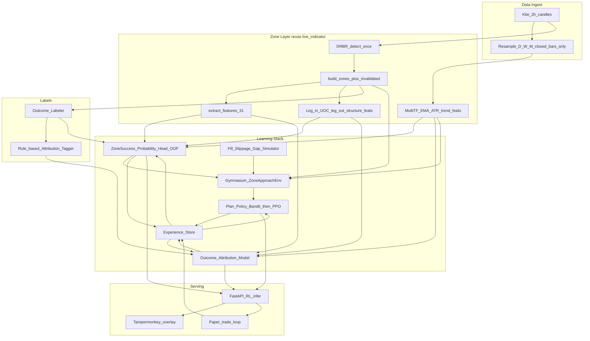

# RL Zone Agent — Architecture Document Plan (v2)

## 0. Changes from v1

v1 had the right hybrid shape but did not say how to prove the model works. v2 adds:

- Exact, configurable **outcome and label definitions**
- **Leakage controls** (including out-of-fold `p_accept`)
- A full **evaluation protocol** with baselines and acceptance criteria
- A **fill, slippage and gap simulation** spec
- A simpler, more trainable **action space** (discrete trade plans)
- A **gated roadmap**: full RL only after simpler policies are beaten
- A **retrain and promotion policy** that defines "continuous learning"
- A **rule-based attribution tagger** so the "why" model has real labels

## 1. Deliverable

Create [`architecture.md`](architecture.md) at the project root. It documents the recommended **approach, tech stack, system architecture, data contracts and validation protocol** for the RL goals. No training code in this step—design only.

## 2. Goals mapped to system components

| # | Goal | Component |
|---|------|-----------|
| 1 | Trade only 2h zones; read 2h/D/W/M trends | Zone engine + multi-TF feature builder |
| 2 | Plan and execute a trade from the UOC area on approach | `ZoneApproachEnv` + policy |
| 3 | Learn from wins and losses; analyse every stop-loss | Outcome labeler + attribution tagger and model |
| 4 | Learn from bounces that happen before the UOC area | `early_bounce` outcome + entry-depth learning |
| 5 | Learn from UOC touch → stop-loss | `uoc_stop` outcome + attribution |
| 6 | Learn why zones that touch UOC and bounce work | `uoc_success` outcome + attribution |
| 7 | Choose entry, exit and target by itself | Policy (plan selection, then management) |
| 8 | Calibrated probability per zone | Probability head with calibration |
| 9 | Analyse full zone structure (leg-in, UOC, leg-out) | Structural features + optional sequence encoder |

## 3. Reality check (from current repo)

- Live stack lives in [`live_indicator/`](live_indicator/) (no `live_indicator_model` folder). Chart overlay: [`tampermonkey_unified_fixed.js`](live_indicator/browser/tampermonkey_unified_fixed.js); scan API: [`unified_server_fixed.py`](live_indicator/api/unified_server_fixed.py).
- Zones are **leg-in → boring/UOC → leg-out** ([`DRBR.py`](live_indicator/api/DRBR.py)); entry rules in [`scan_support_fixed.py`](live_indicator/api/scan_support_fixed.py) / [`zone_tracker_v2.py`](live_indicator/api/zone_tracker_v2.py).
- Current ML is **supervised LightGBM** zone quality (`p_accept`), not a trading agent. Features: 31 columns in [`feature_engineering.py`](live_indicator/api/feature_engineering.py) (TR/ATR ratios, volume, zone geometry). **Missing today:** EMA 20–50, weekly/monthly trends, explicit SL/TP, failure-reason learning. Footprints, delta, and CVD are out of scope.
- Production status is only `fresh` / `worked` (touch). True invalidation (`close < zone_low`) exists in v2 tracker only—RL rewards will standardize on an extended lifecycle.
- **Scope note:** the current pipeline and this plan are **long-only (demand zones)**. Supply zones are out of scope until demand is validated.

## 4. Chosen approach (committed)

**Hybrid structured outcome learning + gated RL**, not end-to-end "black box" RL.

Why this fits the 9 goals better than pure PPO-from-scratch:

1. **Zone success probability** is a calibrated supervised head (LightGBM first), refreshed from outcomes on a schedule.
2. **"Why it failed / worked"** is a **rule-based tagger** (ground truth) plus a multi-label **attribution model**, SHAP, and clustering for discovery—not something RL rewards alone explain.
3. **Entry / exit / target** are the policy's job inside a Gymnasium environment that only activates near 2h zones, with multi-TF context in the observation.
4. **Escalation ladder** (each step must beat the previous one out-of-sample before moving on):
   1. Baseline rules (fixed entry, SL, target)
   2. Probability-filtered baseline (take only zones above a threshold)
   3. Contextual bandit or grid-searched plan policy
   4. PPO with management actions (hold / exit)
   5. Offline RL (d3rlpy) only if enough logged trajectories exist
5. Train **offline** on historical 2h (and resampled D/W/M) replay first; then paper-trade with experience logging. Live capital comes last.

**Why not RL first:** zone episodes are sparse (hundreds to low thousands). Full PPO or SAC on that volume overfits easily, so simpler policies must be beaten before RL is justified.

## 5. Tech stack (locked in `architecture.md`)

| Layer | Choice | Role |
|-------|--------|------|
| Language | Python 3.11+ | Matches existing FastAPI / pandas stack |
| Zone detection | Reuse `live_indicator` DRBR + `scan_support_fixed` | Keep UOC geometry and entry rules as env primitives |
| Indicators | `pandas-ta` (or pure pandas) | EMA 20/50, ATR/TR, multi-TF resampling |
| Structure features | Custom module over leg-in, UOC, leg-out candles; optional small 1D-CNN or GRU encoder later | Goal 9: full zone anatomy. Candle volume vs average only. No footprint, delta, or CVD. |
| Env | **Gymnasium** | `ZoneApproachEnv`: episode when price nears UOC |
| Simulator | Custom fill / slippage / gap / cost module | Realistic fills; shared by backtest and env |
| Baseline policies | Rule-based and grid search (Optuna) | Benchmarks the RL agent must beat |
| RL algo (gated) | **MaskablePPO** over a **discrete plan set** (see §8); management actions (hold / exit) only in the later stage | Stable, sample-efficient for tabular+vector obs |
| RL libs | PyTorch + **Stable-Baselines3** / `sb3-contrib` | Industry default; easy eval callbacks |
| Offline RL (optional) | **d3rlpy** (CQL/IQL) after enough logged trajectories | Learn from historical "would-have" trades without online risk |
| Probability head | **LightGBM** + isotonic or Platt calibration; refreshed on outcome labels | Directly extends `model.txt` / `score_rows` |
| Attribution / "why" | Rule-based tagger (labels) + multi-label LightGBM/sklearn + **SHAP** + HDBSCAN clustering of losers | Maps failures: early_bounce, uoc_touch_sl, trend_against, weak_leg_out, etc. |
| Feature/experience store | Parquet + **DuckDB** (or extend `zone_store` SQLite) | Zone episodes, actions, outcomes, attribution tags |
| Serving | Existing **FastAPI** (`unified_server_fixed` pattern) | New `/rl/decide`, `/rl/outcome` endpoints |
| Experiment tracking | **MLflow** (local) | Metrics, data and model versions, configs |
| HPO | **Optuna** | Reward weights, buffers, thresholds, baseline grids |
| Config | YAML (pydantic-validated) | Every threshold and definition in one versioned place |
| Testing | pytest + property tests for look-ahead | Leakage and simulator correctness |
| Viz | Reuse Tampermonkey; add RL entry/SL/TP lines | Same chart UX |

## 6. Data contracts and label definitions

All thresholds below are **defaults to be tuned and frozen in config before any training**. Once frozen for an experiment, they must not be changed to improve results.

### 6.1 Zone geometry (demand zone)

- `UOC box` = range of the boring candle(s): `[uoc_low, uoc_high]`.
- `zone_low` / `zone_high` = zone boundaries produced by `DRBR` (use as provided by `live_indicator`).
- `proximal` = upper edge of the entry area; `distal` = `zone_low`.

### 6.2 Episode lifecycle

`fresh` → `approaching` → `filled` → `worked` | `invalidated` | `early_bounce` | `timeout`

| Parameter | Default | Meaning |
|-----------|---------|---------|
| `approach_k` | 1.0 × ATR | Episode starts when price is within `k × ATR` above the zone |
| `touch_rule` | `low <= uoc_high` | "Reached the UOC area" |
| `bounce_min_r` | 1.0 R | Minimum rise from the zone to count as a bounce |
| `early_bounce_rule` | Price began episode within `approach_k`, **never** satisfied `touch_rule`, then rose ≥ `bounce_min_r` (measured vs. the plan's would-be SL distance) before the timeout | Goal 4 |
| `invalidation_rule` | 2h close < `zone_low` (v2 tracker semantics) and/or stop hit | Goal 5 |
| `timeout_bars` | N 2h bars (tune per instrument volatility) | Episode ends with no resolution |
| `max_retests` | 1 (first touch only) for v1 | Later: model retests as separate episodes |

### 6.3 Terminal outcomes

| Outcome | Rule |
|---------|------|
| `early_bounce` | See §6.2. Plan not filled, or filled only if the entry depth was shallow enough |
| `uoc_success` | `touch_rule` met, entry filled, target reached before stop |
| `uoc_stop` | `touch_rule` met, entry filled, stop reached before target |
| `timeout` | No resolution within `timeout_bars`, or trend invalidation per config |
| `never_approached` | Excluded from training; kept in the dataset for base-rate reporting |

Every episode also stores: `mae_r`, `mfe_r`, `r_multiple`, `bars_to_resolution`, `fill_price`, `fill_bar`.

### 6.4 Same-bar ambiguity (conservative)

If stop and target are both inside one bar's range, assume **stop first**. If the bar gaps through the stop, fill at the **open**, not at the stop price.

### 6.5 Multi-timeframe data rules (anti look-ahead)

- At decision time `t`, every higher-timeframe feature uses only the **last fully closed** bar of that timeframe.
- Daily, weekly and monthly bars are built from closed sessions only; never use the in-progress bar.
- Verify how Kite builds 2h bars (session boundaries and the short final bar) and keep resampling consistent with the chart.
- Add a unit test that recomputes each feature on data truncated at `t` and asserts equality with the full-history result.

### 6.6 Attribution tags (rule-based v1)

Multi-label tags written at episode end. Examples (final list to be fixed in config):

- `early_bounce` — bounce before the UOC area was reached
- `uoc_touch_sl` — UOC reached, stop hit
- `trend_against_htf` — daily / weekly / monthly trend opposed the trade
- `weak_leg_out` — leg-out size, speed or volume below threshold
- `wide_uoc` — boring candle range too large relative to ATR
- `high_volume_uoc` — volume at the UOC unusually high (possible absorption against the trade)
- `stale_zone` — zone age or retest count above threshold
- `htf_supply_overhead` — higher-timeframe resistance close above the entry
- `volatility_spike` — ATR regime shifted sharply during the episode
- `gap_through_stop` — stop skipped by a gap

After the tagger has produced a labeled set, **SHAP and clustering are used to discover failure patterns the rules did not cover**, and confirmed patterns become new tagger rules.

## 7. Observation, reward and training signals

**Episode trigger:** 2h zone `fresh` and price within `approach_k × ATR` of `[zone_low, zone_high]` (UOC box).

**Observation:** concat of:

- (a) existing 31 zone features
- (b) multi-TF trend vector (2h/D/W/M EMA20–50 slope & position, ATR regime)
- (c) approach context (distance to UOC mid, time since formation, volume surge)
- (d) structure features: leg-in and leg-out size, speed, body-to-range ratio, candle count; UOC range / ATR, wick structure, volume vs. average
- (e) `p_accept` from the probability head — **out-of-fold only** (see §9)
- (f) position state if in trade

**Reward:** net R-multiple after costs, slippage and gap effects.

- `skip` and unfilled plans give reward `0`.
- A small bonus for calibrated confidence is optional and must be ablated.
- **No penalty for violating the zone-only rule**: the environment only activates near zones, so the rule is enforced by design.
- Attribution labels are written at episode end for the "why" model and are **not** the only reward.

## 8. Action space

Use a **discrete set of trade plans** so one algorithm and one head suffice. Continuous heads are avoided in v1.

- `skip`
- `plan(entry_depth, sl_buffer, target)` where:
  - `entry_depth` ∈ {0%, 25%, 50%, 75%} into the UOC box from `proximal`
  - `sl_buffer` ∈ {0.10, 0.25, 0.50} × ATR below `zone_low`
  - `target` ∈ {1.5R, 2R, 3R, next HTF supply zone}

Management actions (`hold`, `exit`, move-to-breakeven) are added **only in the PPO stage**, after the plan-selection policy has been validated.

Entry depth is how the agent learns goal 4: shallow entries catch early bounces but are exposed to more stop-outs, while deep entries miss early bounces.

## 9. Leakage controls (mandatory)

1. **Out-of-fold `p_accept`:** the probability head is trained with time-aware cross-validation. The value fed to the RL environment for any zone must come from a model that never saw that zone (or any later zone).
2. **Purged and embargoed splits:** remove or embargo zones whose episodes overlap the train/test boundary in time.
3. **Closed-bar HTF features only** (§6.5).
4. **Frozen label definitions** (§6) before training.
5. **No tuning on the final test set.** Hyperparameters, thresholds and reward weights are tuned on validation folds only.
6. **Feature timestamps:** every feature is stamped with its availability time, and a test verifies `availability_time <= decision_time`.
7. **Zone formation timing:** a zone becomes usable only after its leg-out is confirmed, not at its first appearance on the chart.

## 10. Evaluation protocol and acceptance criteria

### 10.1 Splits

- **Walk-forward:** train on a rolling or expanding past window and test on the next period; repeat across the full history.
- **Hold-out instruments:** a fixed set of instruments never used for training or tuning.
- **Hold-out final period:** the most recent segment, touched once, at the end.

### 10.2 Baselines (the agent must beat all of them)

1. Take every zone, fixed plan (for example 25% depth, 0.25 ATR buffer, 2R).
2. Same, filtered by `p_accept` above a threshold chosen on validation.
3. Best grid-searched static plan (tuned on validation).
4. Contextual bandit plan policy (before PPO is attempted).

### 10.3 Metrics

- Net expectancy (R per trade) after costs; win rate; profit factor
- Max drawdown and longest losing streak
- Fill rate; `early_bounce` capture rate
- **Calibration:** reliability curve, Brier score, expected calibration error
- Results split by instrument, year, volatility regime and zone type
- Bootstrap confidence intervals on expectancy

### 10.4 Acceptance criteria (set in config before the run; defaults)

- Positive net expectancy after costs on **walk-forward and hold-out instruments**
- Lower bound of the bootstrap CI for expectancy **> 0**
- Beats the best baseline by a pre-agreed margin on the hold-out period
- Stable across periods (no single year or instrument carries the result)
- At least **300 out-of-sample trades** before any conclusion (raise the number if variance is high)
- Probability calibration error under a stated threshold

### 10.5 Multiple-testing caution

Record every experiment in MLflow, including failed ones. Treat the best of many runs as optimistic and confirm it on untouched data.

## 11. Fill, slippage and cost simulator

- **Limit-fill model:** a limit entry fills only if the bar's low reaches the entry; optionally require a trade-through or penetration depth to avoid assuming a fill at the exact touch.
- **Gaps:** gap through entry fills at the open; gap through stop fills at the open (worse than the stop).
- **Slippage:** configurable (ATR fraction or ticks).
- **Costs:** brokerage, taxes and exchange charges for the instrument class, parameterized per instrument and kept in config.
- **Same-bar ambiguity:** stop assumed first (§6.4).
- The **same simulator** is used in the backtest, the Gymnasium environment and the paper-trade loop.

## 12. Training loop

1. **Dataset build:** run detection over full history → label outcomes → compute features → write Parquet with version hashes.
2. **Probability head:** time-aware CV → calibrated, out-of-fold predictions → MLflow.
3. **Attribution:** rule-based tagger → train the multi-label model → SHAP and clustering reports.
4. **Policies, in order of the escalation ladder (§4):** baselines → bandit / grid policy → PPO (gated).
5. **Evaluation:** protocol in §10 on every candidate.
6. **Paper trading:** a minimum of **3 months** with live data, the same simulator, and logged experience; compare against backtest expectations.
7. **Live (small size):** only if paper results match backtest expectations within tolerance.

## 13. Continuous learning, retraining and promotion

- **Retrain on a schedule** (for example monthly or after N new episodes), not after every trade.
- **Champion / challenger:** a new model is promoted only if it beats the current model on a rolling hold-out and the acceptance criteria in §10.4.
- **Experience store:** every episode logs observation, action, outcome, tags and model versions so any result can be reproduced.
- **Drift monitoring:** track feature distributions, calibration and expectancy; alert on degradation.
- **Kill switch:** automatically stop signalling or trading if drawdown or calibration drift exceeds set limits.
- **Rollback:** previous champion remains available for immediate reversion.

## 14. How `architecture.md` will be structured

1. Goals mapped to system components
2. Current system vs gaps
3. Recommended approach (hybrid) and escalation ladder
4. Tech stack table
5. Component architecture + data flow diagram
6. Data contracts and label definitions (outcomes, lifecycle, attribution tags)
7. Observation / action / reward taxonomy
8. Leakage controls
9. Evaluation protocol, baselines and acceptance criteria
10. Fill / slippage / cost simulator
11. Training loop (offline replay → paper → optional live)
12. Continuous learning, retraining and promotion policy
13. Integration points with existing files
14. Phased roadmap with gates (§16)
15. Risks and mitigations (§17)

## 15. Integration anchors (documented, not coded yet)

- Reuse: `detect_once`, `build_zones`, `extract_features`, `score_rows`, `_daily_atr`, `zone_tracker_v2._status`
- Extend lifecycle to the production path: `fresh` → `approaching` → `filled` → `worked` | `invalidated` | `early_bounce`
- New package (future): `rl_zone_agent/` beside `live_indicator/`, with submodules:
  - `data/` (ingest, resample, versioning)
  - `features/` (multi-TF, structure, proxies)
  - `labels/` (outcome labeler, attribution tagger)
  - `sim/` (fills, costs)
  - `models/` (probability, attribution)
  - `env/` (`ZoneApproachEnv`)
  - `policies/` (baselines, bandit, PPO)
  - `eval/` (walk-forward, metrics, calibration)
  - `serve/` (FastAPI endpoints)
  - `configs/`
  - `tests/`
- Data: historical 2h from cron [`scan_fresh_zones.py`](crone-job/scan_fresh_zones.py) + resampled HTF bars
- Do not rely on `kite_candle_scraper.js` for training data; prefer the official Kite Connect API where the terms allow it

## 16. Phased roadmap with gates

| Phase | Deliverable | Gate to continue |
|-------|-------------|------------------|
| 0 | Frozen definitions (§6), config schema, leakage tests, versioned zone dataset with outcome labels | Label counts and base rates reviewed; leakage tests pass |
| 1 | Multi-TF and structure features; calibrated out-of-fold probability head with SHAP report | Beats "take every zone" baseline out-of-sample; calibration acceptable |
| 2 | Rule-based attribution tagger + attribution model + failure clustering | Tags reviewed manually on a sample of losing zones |
| 3 | Simulator and `ZoneApproachEnv`; baseline and grid-searched plan policies; contextual bandit | Bandit beats best static plan on walk-forward |
| 4 | Gated PPO (plan selection, then management actions) | Beats bandit under §10.4 criteria |
| 5 | FastAPI `/rl/decide` and `/rl/outcome`, Tampermonkey RL lines, paper-trade loop (min. 3 months) | Paper results consistent with backtest |
| 6 | Retrain and promotion automation, drift monitoring, kill switch; optional small live | Champion/challenger process proven |

If a gate fails, stop and fix the data, features or definitions before adding model complexity.

## 17. Risks and mitigations

| Risk | Mitigation |
|------|------------|
| Look-ahead bias | Closed-bar HTF rule, availability timestamps, truncation tests |
| Stacking leakage via `p_accept` | Out-of-fold predictions only |
| Too few episodes for RL | Escalation ladder; bandit before PPO; pool instruments; consider offline RL later |
| Non-stationarity / regime change | Walk-forward testing, drift monitoring, scheduled retrain with promotion gate |
| Unrealistic fills in backtest | Conservative simulator (§11); paper trading before live |
| Overfitting and multiple testing | Frozen definitions, hold-out instruments and period, experiment log, bootstrap CIs |
| Label ambiguity | Explicit rules, same-bar convention, manual review of samples |
| Continuous learning degrading the model | Champion/challenger promotion, rollback, kill switch |
| No edge exists for some zone types | Report results per zone type and let the probability head and policy skip them; an honest "no edge" result is a valid outcome |

## 18. Out of scope for this step

Implementing the env, training runs, or live order routing. Deliverable is **`architecture.md` only**.
